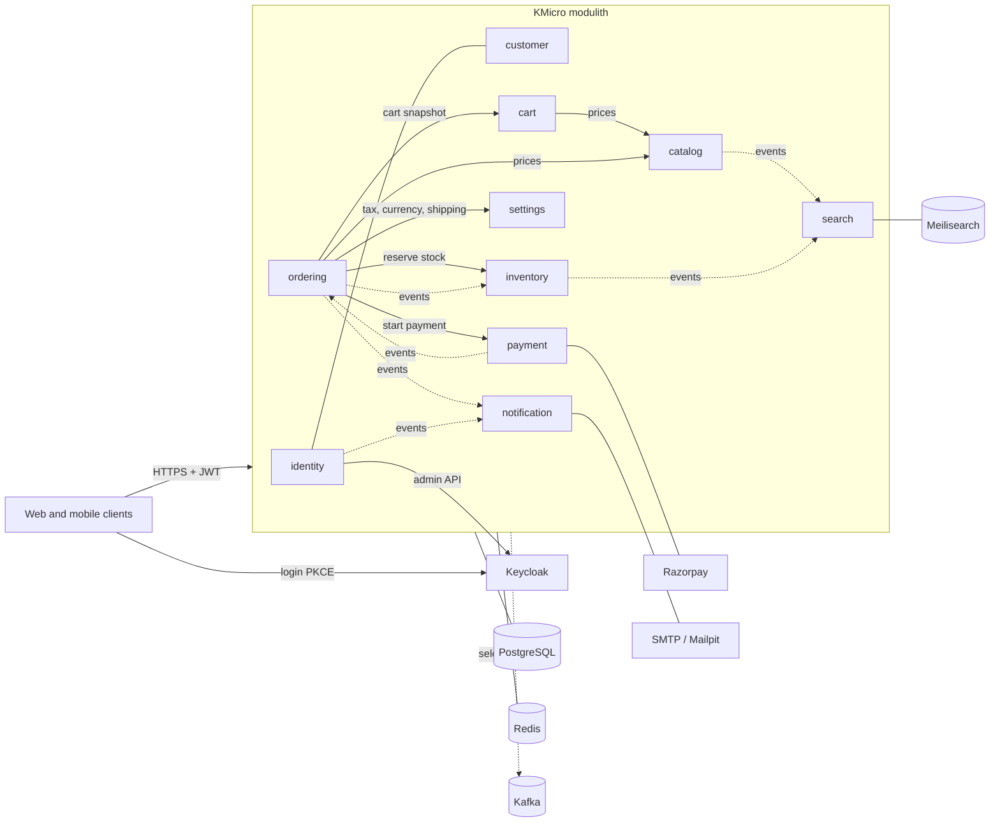
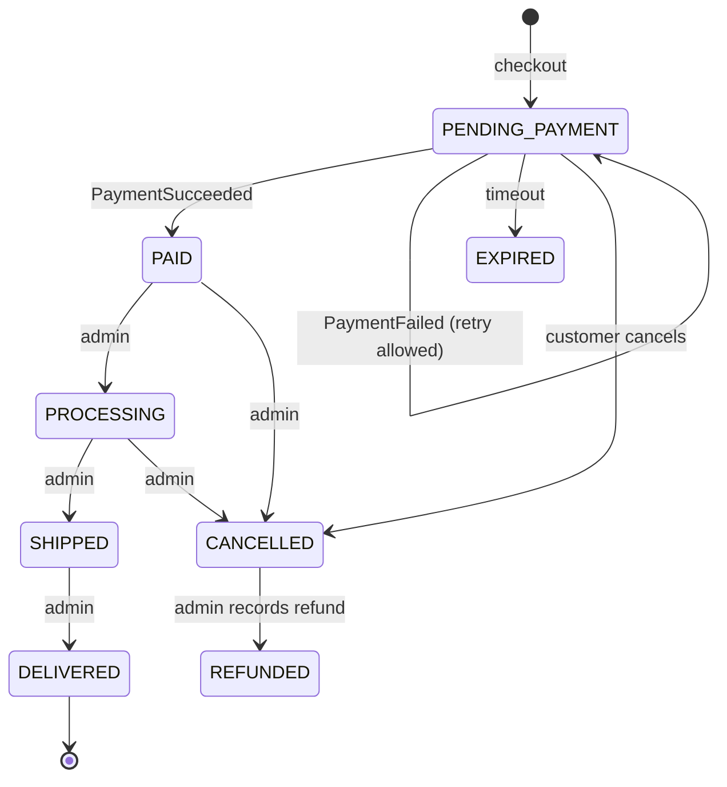
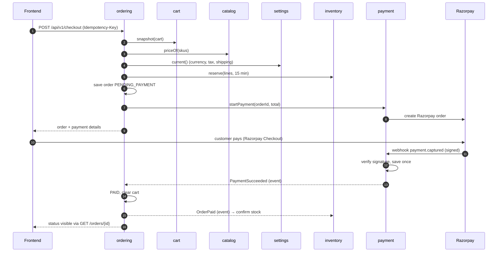

> Source of truth: this file is a copy of the live design doc. Live version: https://claude.ai/artifact/C8raxyWLmuBLcZHVGKYfHT. If they differ, ask the owner which one wins.

Backend design doc · v8

# KMicro Backend Design

Owner: krprod · Date: 30 Oct 2026 · Status: draft for review

This document describes the new KMicro e-commerce app. It is built as a **modulith**: one Spring Boot app split into strict modules. Each module can later become its own microservice with little rework. It replaces the earlier kmicro microservices, keeps what worked there, and fixes the problems found in review.

This is one of three design docs: **Backend** (this one), [Frontend](https://claude.ai/artifact/9gykGWLs5ALGW7rappCiFW), and **Deployment** (to be written). Hosting, CI/CD and production setup belong in the deployment doc.

## Decisions

All of these were agreed in our discussion. "Open" items are listed in section 17.

| Area              | Decision                                                                                                                                                                                                                               | Status         |
|-------------------|----------------------------------------------------------------------------------------------------------------------------------------------------------------------------------------------------------------------------------------|----------------|
| Architecture      | Spring Modulith. One app, one Maven project, one package per module, boundaries checked by tests.                                                                                                                                      | **Locked** |
| Modules (phase 1) | identity, customer, catalog, search, inventory, cart, ordering, payment, notification, settings, promotion, review                                                                                                                     | **Locked** |
| Between modules   | In-app events saved in the database (Spring Modulith event registry). Selected events also go to Kafka.                                                                                                                                | **Locked** |
| Broker            | Apache Kafka in KRaft mode (no ZooKeeper), single node locally. Kafbat UI.                                                                                                                                                             | **Locked** |
| Login             | Keycloak. Web: the app is a BFF (it logs in for the browser and keeps tokens in a Redis session; browser gets an HttpOnly cookie). Mobile: PKCE, Bearer tokens. The app is also an OAuth2 Resource Server for mobile.                  | **Locked** |
| Database          | One PostgreSQL database, one schema per module, Flyway. No joins or foreign keys across schemas.                                                                                                                                       | **Locked** |
| Cache             | Redis from day 1: Spring Cache, rate limiting and web login sessions (Spring Session). RedisInsight UI.                                                                                                                                | **Locked** |
| Search            | Meilisearch from day 1, kept in sync by catalog events.                                                                                                                                                                                | **Locked** |
| Money             | `BigDecimal` amount + ISO currency code. Never `double`.                                                                                                                                                                               | **Locked** |
| Currency          | One store currency, chosen by admin from the ISO list. On change, admin re-enters prices. Products without a price in the new currency are hidden.                                                                                     | **Locked** |
| Tax               | One store-wide rate. Admin sets name (GST, VAT, Sales tax…), percent, and whether prices include tax.                                                                                                                                  | **Locked** |
| Payment           | `PaymentProvider` interface: Fake provider (dev) and Razorpay (test mode). Webhook signature check.                                                                                                                                    | **Locked** |
| Files             | `FileStorage` interface: local folder, S3 (LocalStack locally), Cloudinary later.                                                                                                                                                      | **Locked** |
| Guest checkout    | Yes. Optional "create my account" at checkout.                                                                                                                                                                                         | **Locked** |
| Shipping          | Admin sets a flat fee and, optionally, a "free shipping above" amount. Both can be used together.                                                                                                                                      | **Locked** |
| Variants          | Admin defines option types (Size, Color, Weight, or anything else) and their values. Each variant is its own SKU with its own price and stock.                                                                                         | **Locked** |
| Refunds           | Phase 1: no automatic refunds. Admin cancels the order, refunds in the Razorpay dashboard, and records it in the app (reference + date). Full and partial refunds through the Razorpay API come in a later phase (plan in section 16). | **Locked** |
| Phases            | Phase 1: core shop + basic shipping info + basic coupons + ratings and one-level reviews. Phase 2: mobile app only. Phase 3+: API refunds, carrier integration, abandoned cart, multi-vendor.                                          | **Locked** |
| Order number      | Admin sets the prefix (e.g. `KM-2026`). The app appends a 6-digit counter: `KM-2026-000123`.                                                                                                                                           | **Locked** |
| Frontend          | Web frontend built on kmicro-frontend, alongside phases 1–2 (see the frontend doc). Mobile app in phase 3. The API serves both.                                                                                                        | **Locked** |
| API               | Redesigned, versioned `/api/v1`. The user always comes from the token, never from the URL.                                                                                                                                             | **Locked** |
| Local dev         | IntelliJ Run with Spring Boot Docker Compose support. Compose profiles keep the laptop light.                                                                                                                                          | **Locked** |
| Deployment        | Covered in the separate deployment doc.                                                                                                                                                                                                | **Open**   |

## Scope and phases

### Goals

- Production-grade code for a demo with 20–40 real users testing at the same time.
- No known security holes: no forged headers, no access to other users' data, no client-set prices.
- Any module can be moved out to its own service later without rewriting its business logic.
- Easy local setup: clone, start Docker, press Run in IntelliJ.
- One API that works the same for a web frontend and a mobile app (phase 3).

### Phase 1: core shop

Browse and search products with admin-defined variants, cart (guest and logged in), checkout, payment (fake and Razorpay test), order tracking, emails, wishlist, and admin management of catalog, stock, orders and store settings. Also in phase 1, kept basic:

- **Shipping info:** carrier name, tracking number and optional tracking link added by admin when shipping; "your order shipped" email.
- **Coupons:** codes with % or fixed discount, minimum order, dates and usage limits (section 6).
- **Ratings and reviews:** 1–5 stars plus optional text from verified buyers. One level only: no replies or comments.
- **Refunds:** recorded by admin after refunding in the Razorpay dashboard.

The web frontend (kmicro-frontend, reworked) is built alongside phase 1. Testers can start once checkout works. Details are in the frontend doc.

### Phase 2: mobile app (lean)

A React Native app with the same features as the web shop, using the same `/api/v1`. No new backend features, so the app can ship fast.

### Phase 3 and later

Refunds through the Razorpay API (full and partial), carrier integration (live rates, labels, tracking updates), abandoned-cart reminders, and the multi-vendor marketplace. Phase 1 data is shaped so that these plug in without rewrites (see section 16).

### Not in scope

- Many currencies shown at once, and automatic currency conversion.
- Different tax rates per category or per region.
- Shipping rates by weight, zone or carrier (later phase).
- Automatic promotions (buy one get one, bundles), more than one coupon per order, and coupons for free shipping or specific products (later phase).
- Multiple warehouses.
- A native mobile app.

## Architecture

There is one deployable Spring Boot app. Inside it, each module owns its own code, database schema and API. Modules talk in two ways:

- **Direct call** to another module's public API interface, when an answer is needed right now (for example, "reserve this stock").
- **Event**, when something happened and others may react (for example, "order paid"). Events are saved in the database first, so none are lost if the app crashes.



Solid arrows are direct calls. Dotted arrows are events. No module calls "up" into a module that depends on it, so there are no cycles. Spring Modulith tests fail the build if a cycle appears.

There is **no API gateway** in phase 1. With one app, a gateway only adds a hop. In production a reverse proxy (Nginx, Caddy or a cloud load balancer) handles TLS. A gateway comes back when the first module is moved out (section 14).

## Modules

Each module has one job and owns its data. Other modules see only its `api` package and its `events`.

### identity `identity`

Owns  
Link between Keycloak and the app: user id (Keycloak `sub`), roles, account status. Creating Keycloak users for "create account at checkout".

Publishes  
`UserRegistered`, `AccountCreatedFromCheckout`

Note  
Small on purpose. Keycloak does passwords, email verification, lockout and MFA.

### customer `customer`

Owns  
Profile (name, phone), addresses, wishlist (SKUs saved by the customer), notification preferences and consent (needed later for push).

Listens  
`UserRegistered` → create an empty profile

API  
`CustomerApi.getAddress(customerId, addressId)`

### catalog `catalog`

Owns  
Products, categories, admin-defined option types (Size, Color, Weight…) and their values, variants (one SKU each, with its own price, weight and images), active flag, `sellerId`.

Publishes  
`ProductChanged`, `ProductRemoved`, `PriceChanged`

Listens  
`StoreCurrencyChanged` → mark prices for re-entry

API  
`CatalogApi.priceOf(skus)`, `CatalogApi.isSellable(sku)`

### search `search`

Owns  
The Meilisearch product index and its settings (searchable, filterable and sortable fields).

Listens  
Catalog and inventory events → update the index

Note  
Admin can rebuild the index from the database at any time. Category browsing still works from Postgres if Meilisearch is down.

### inventory `inventory`

Owns  
Stock per SKU, reservations with an expiry time.

API  
`InventoryApi.reserve(orderId, lines)` → reservation or "out of stock"

Listens  
`OrderPaid` → confirm; `OrderCancelled` / `OrderExpired` → release

Publishes  
`StockLevelChanged` (in stock / out of stock)

### cart `cart`

Owns  
Carts and items: SKU and quantity only, **no price**. Owner is a customer id or a guest cart token. Last-activity time (needed for abandoned cart).

API  
`CartApi.snapshot(cartId)`; merge guest cart on login

Note  
Stored in Postgres, not Redis. Carts must last and be queryable.

### ordering `ordering`

Owns  
Orders, order lines (with `sellerId`), price, discount and tax snapshot, shipping address snapshot, shipment info (carrier, tracking number, link), manual refund record, status history, guest email, order number.

Runs  
The checkout flow (section 7). Expires unpaid orders.

Publishes  
`OrderPlaced`, `OrderPaid`, `OrderCancelled`, `OrderExpired`, `OrderStatusChanged`

### payment `payment`

Owns  
Payment attempts, provider references, webhook log. Refunds through the provider API come in a later phase.

Providers  
`FakePaymentProvider` (dev; you choose success or fail), `RazorpayPaymentProvider` (test mode)

Publishes  
`PaymentSucceeded`, `PaymentFailed` (later: `RefundCompleted`)

### promotion `promotion`

Owns  
Coupons and their rules, coupon reservations and redemptions.

API  
`PromotionApi.quote(code, itemsTotal, customer)` → discount or reason; `reserve(code, orderId)`

Listens  
`OrderPaid` → count as used; `OrderCancelled` / `OrderExpired` → free the reservation

### review `review`

Owns  
Ratings (1–5) and review text, one per customer per product; hidden flag set by admin; rating summary per product.

Listens  
`OrderStatusChanged` (delivered) → remember who may review what

Publishes  
`ProductRatingChanged` → search updates average and count

### notification `notification`

Owns  
Email templates (Thymeleaf), delivery log, retry of failed sends.

Listens  
Order, payment and identity events → send emails

Note  
Only listens. Nobody calls it directly. This makes it the easiest module to move out first.

### settings `settings`

Owns  
Store name, currency, tax (name, rate, prices-include-tax), shipping (flat fee, optional free-shipping amount), order number prefix, unpaid-order timeout.

API  
`SettingsApi.current()` (cached in Redis)

Publishes  
`StoreCurrencyChanged`, `TaxSettingsChanged`

Shared kernel (`shared`), kept very small: `Money`, typed IDs (`OrderId`, `Sku`…), the error format, and clock/time helpers. Business logic never goes here.

There is no "admin" module. Admin is a role. Each module has its own admin endpoints under `/api/v1/admin/<module>/…`. This keeps every rule about orders inside ordering, every rule about stock inside inventory, and so on.

## Module rules

### Package layout

``` code
com.kmicro
├── KmicroApplication.java
├── shared/                     # Money, ids, errors (tiny)
├── catalog/
│   ├── api/                    # public: CatalogApi, DTOs   (@NamedInterface)
│   ├── events/                 # public: ProductChanged…    (@NamedInterface)
│   ├── web/                    # REST controllers (internal)
│   ├── domain/                 # entities, rules (internal)
│   ├── persistence/            # repositories (internal)
│   └── package-info.java       # @ApplicationModule(allowedDependencies = {"shared", "settings::api"})
├── ordering/ …
└── …
```

### The rules

1.  A module may use only another module's `api` and `events` packages. Everything else is internal. `ApplicationModules.verify()` fails the build otherwise.
2.  A module reads and writes only its own schema. Other modules' data is reached through their API, never through SQL or a shared JPA entity.
3.  Data from other modules is referred to by ID only, never by a JPA relation. Where a value must not change later (price, address, tax), the module keeps a **snapshot** copy.
4.  API methods take and return simple DTOs (Java records), never entities. Later, the same interface gets an HTTP client implementation.
5.  Event listeners use `@ApplicationModuleListener`. Each runs in its own transaction after the sender commits, and the event registry retries until the listener succeeds.
6.  Every listener is idempotent: handling the same event twice has no extra effect.
7.  No cycles between modules.

## Data and money

### Schemas

One database, one schema per module: `identity`, `customer`, `catalog`, `search` (index bookkeeping only), `inventory`, `cart`, `ordering`, `payment`, `notification`, `settings`, `promotion`, `review`, plus `modulith` for the event registry. Flyway migrations live in one folder per module (`db/migration/<module>`).

### IDs

- Internal IDs are UUIDs (time-ordered UUIDv7, so they index well). IDs cannot be guessed, unlike today's sequential numbers.
- Orders also get a human-friendly number for emails and support: the admin's prefix + `-` + a 6-digit counter, e.g. `KM-2026-000123`. The counter is a database sequence, so two orders never get the same number. The full number has a unique index. After 999999 the counter simply grows to 7 digits. When admin changes the prefix, the counter keeps going (e.g. `KM-2026-000123` → `KM-2027-000124`); it never restarts.
- The customer ID is the Keycloak user ID (`sub`).

### Money

- A `Money` value holds `BigDecimal amount` and `CurrencyCode currency`. In the database: `numeric(19,4)` + `char(3)`.
- Rounding uses the currency's own decimal places (e.g. 2 for INR and USD, 0 for JPY), rounding half up, applied per order line.
- Adding two amounts in different currencies throws an error.

### Tax

Settings hold: `taxName` (e.g. "GST"), `taxRate` (e.g. 18.00), `pricesIncludeTax` (true/false).

``` code
pricesIncludeTax = true :  tax = price − price / (1 + rate/100)    total = price
pricesIncludeTax = false:  tax = price × rate/100                  total = price + tax
```

Each order stores the tax name, rate and mode used at the time of purchase. Changing settings later never changes old orders.

### Price order at checkout

``` code
1. itemsTotal   = sum of (catalog price × quantity)
2. discount     = coupon on itemsTotal (never more than itemsTotal)
3. tax          = computed on (itemsTotal − discount), using the store tax mode
4. shipping     = flat fee, or 0 if (itemsTotal − discount) ≥ free-shipping amount
5. total        = (itemsTotal − discount) [+ tax if added] + shipping
```

### Coupons (basic)

- Admin creates a code (e.g. `WELCOME10`): **% off** (with an optional maximum discount) or **fixed amount** off.
- Rules: minimum order amount, start and end date, total usage limit, per-customer limit (default 1; guests counted by email), active on/off.
- One coupon per order. It applies to items only, not shipping.
- At checkout the coupon is **reserved** for the order. It counts as used when the order is paid, and is freed if the order expires or is cancelled. Two people can't both take the last use.
- Wrong or expired codes get a clear reason ("Minimum order is ₹999") with the same error format as everything else. Coupon checks are rate-limited to stop code guessing.

### Ratings and reviews (basic)

- Only a customer whose order with that product was **delivered** can review it. Guests can't review.
- 1–5 stars plus optional text (max 2000 characters, plain text only). One review per customer per product; the customer can edit or delete it.
- Reviews appear right away. Admin can hide a review (with a reason). There are no replies or comments.
- Average rating and count are kept per product and sent to search, so shoppers can sort and filter by rating.

### Shipping info (basic)

- When admin moves an order to `SHIPPED`, they enter the carrier name, tracking number and an optional tracking link. The customer gets a "shipped" email and sees the info on the order page.
- One shipment per order. No carrier API yet.

### Shipping fee

``` code
if freeShippingAbove is set and itemsTotal ≥ freeShippingAbove:  shipping = 0
else:                                                              shipping = flatFee
```

Admin can set both, only the flat fee, or a flat fee of 0. `itemsTotal` is the total of the items after tax rules are applied, before shipping. Like tax, the shipping fee is stored on the order.

### Variants

- Admin creates **option types** (e.g. Size, Color, Weight, Material) and their **values** (S, M, L; Red, Blue; 500 g, 1 kg).
- A product picks which option types it uses. Each allowed combination is a **variant** with its own SKU, price, stock (in inventory) and images.
- A product with no options has exactly one variant, so cart, orders and inventory always work with SKUs.
- Search indexes variant options as filters (e.g. "Size: M").

### Currency change

1.  Admin picks a new currency in settings → `StoreCurrencyChanged`.
2.  Catalog marks every price in the old currency as "needs price". These products drop out of search and listings and cannot be added to cart.
3.  Carts with such items show them as "not available".
4.  Admin re-enters prices (one by one, or by bulk CSV upload). Each product appears again once priced.
5.  Existing orders keep their original currency.

### Order status



Only these moves are allowed. The order entity checks every change, so admin cannot jump from, for example, `PENDING_PAYMENT` to `SHIPPED`.

## Key flows

### Checkout and payment



- **Prices come from catalog**, never from the client.
- **Stock is reserved before payment.** If payment never comes, the order expires and the reservation is released.
- **The webhook decides.** The browser callback only shows a "processing" screen; the signed webhook is the source of truth. Webhooks are saved by provider event ID, so a repeated webhook is ignored.
- **Idempotency-Key** on checkout: a double click or network retry returns the same order instead of creating two.
- With the Fake provider, the same flow runs, but the "webhook" is a dev-only endpoint where you choose success or failure.

Steps 2–6 call other modules directly, which is safe while everything is in one app. When ordering or inventory is moved out, the reservation becomes a saga step with an undo ("release") action. The interfaces stay the same.

### Guest checkout and "create my account"

1.  A guest gets a random cart token when the first item is added. The client sends it back in an `X-Cart-Token` header. A header (not a cookie) works the same for web and mobile.
2.  At checkout the guest gives an email and address. The order stores the guest email.
3.  The confirmation email has a signed link for viewing the order. No login is needed, and the link expires.
4.  If the guest ticks "create my account", then after payment identity creates the Keycloak user. Keycloak sends a "verify email and set password" email.
5.  On first login with a verified email, past guest orders with that email are linked to the account.
6.  When a guest logs in while holding a cart, the guest cart merges into the customer's cart. For the same item, the larger quantity wins.

### Search sync

1.  Catalog saves a product → `ProductChanged` (saved in the event registry in the same transaction).
2.  The search module listens and writes the document to Meilisearch. If Meilisearch is down, the event stays "incomplete" and is retried.
3.  Inventory publishes `StockLevelChanged` only when a SKU goes in stock or out of stock (not on every unit), to keep index writes low.
4.  Admin action "Rebuild search index" re-sends all sellable products.

## Events and Kafka

All events are Java records in each module's `events` package. Spring Modulith saves each event in the `modulith.event_publication` table in the same transaction as the business change. This replaces the hand-written outbox from kmicro, and it marks an event done only after the listener succeeds.

### Sent to Kafka (externalized)

Only events that something outside the app may need. They are marked with `@Externalized`.

| Topic                    | Events                                                     | Key       | Why                                     |
|--------------------------|------------------------------------------------------------|-----------|-----------------------------------------|
| `kmicro.ordering.order`  | OrderPlaced, OrderPaid, OrderCancelled, OrderStatusChanged | orderId   | Analytics; future extracted services    |
| `kmicro.payment.payment` | PaymentSucceeded, PaymentFailed, RefundCompleted           | orderId   | Finance and reporting                   |
| `kmicro.catalog.product` | ProductChanged, ProductRemoved, PriceChanged               | productId | Future search or recommendation service |

- Message format: JSON with `eventType`, `eventVersion`, `eventId`, `occurredAt`, and the payload. Headers carry the trace ID.
- Topics are created by the app (`NewTopic` beans). Auto-create is off.
- Springwolf documents these topics, as in kmicro.
- Kafka can be switched off with a profile. The app then still works, because in-app events don't need Kafka.

## Security

### Login and tokens

- Keycloak realm `kmicro` with public PKCE clients for the web app and the mobile app (phase 3), and a confidential client for the app's admin API calls.
- Access tokens last 5 minutes and refresh tokens are used for longer sessions. Logout ends the Keycloak session.
- The app checks tokens with Spring Security OAuth2 Resource Server, using Keycloak's public keys. There is no custom JWT filter and no Redis blacklist.
- Roles: `CUSTOMER`, `ADMIN`; `SELLER` in phase 2. Roles are read from the token and checked with `@PreAuthorize`.
- Keycloak handles brute-force protection, email verification, password policy and optional MFA.
- **Google and Facebook login (later):** added as identity providers in Keycloak, with no app code change. An existing account with the same email is linked only after the user confirms. Details are in the frontend doc.
- **Two login modes, two Spring Security filter chains:**
  - *Web (BFF):* `oauth2Login` against Keycloak. Tokens are kept in a Spring Session stored in Redis. The browser gets a `__Host-` prefixed `HttpOnly`, `Secure`, `SameSite=Lax` session cookie. The app refreshes tokens itself. Endpoints: `/bff/login`, `/bff/logout`, `/bff/me`.
  - *Mobile:* `Authorization: Bearer` token checked as an OAuth2 Resource Server.

  Both modes reach the same `/api/v1` controllers and the same `@PreAuthorize` rules.

### Access rules

- Customer endpoints live under `/api/v1/me/…`. The user ID always comes from the token.
- When loading a resource by ID (an order, an address), the query includes the owner: `findByIdAndCustomerId`. Someone else's ID gives 404, not 403, so it doesn't reveal that the resource exists.
- Admin endpoints live under `/api/v1/admin/…` and need role `ADMIN`. They are checked at both URL and method level.
- Public endpoints: product browse and search, cart (with cart token), checkout, guest order view (with signed link).

### Other protections

| Risk                         | Protection                                                                                                                                                                                                                    |
|------------------------------|-------------------------------------------------------------------------------------------------------------------------------------------------------------------------------------------------------------------------------|
| Fake payment webhooks        | HMAC signature check with the Razorpay webhook secret; stored by event ID                                                                                                                                                     |
| Too many requests            | Bucket4j + Redis rate limits per IP and per user on checkout, search, guest order view and cart writes                                                                                                                        |
| Bad input                    | Bean Validation on every request DTO; size limits on lists and uploads                                                                                                                                                        |
| Upload abuse                 | Admin-only uploads; check file type by content, size limit, random file keys                                                                                                                                                  |
| Secrets in git               | All secrets come from env vars or a `.env` file (git-ignored); a `.env.example` is committed                                                                                                                                  |
| CSRF                         | Web session cookie requests: Spring Security CSRF protection (readable `XSRF-TOKEN` cookie copied to an `X-XSRF-TOKEN` header) plus `SameSite=Lax`. Bearer-token (mobile) requests don't need it                              |
| CORS                         | Allow only the frontend origin(s) from config                                                                                                                                                                                 |
| Leaky errors                 | One error handler returning RFC 9457 Problem Details; no stack traces to clients                                                                                                                                              |
| Data in logs                 | No tokens, passwords or full card or payment data in logs; emails partly masked                                                                                                                                               |
| Open infra ports             | Infra ports are published for local dev only, never in production                                                                                                                                                             |
| Bad or hijacked dependencies | Few libraries; exact versions; Renovate update PRs with a 7-day cooldown; OSV-Scanner / OWASP dependency check in CI; Docker images pinned by digest and scanned with Trivy; latest stable Spring Boot patch at project start |

## API design

### Conventions

- Base path `/api/v1`. Resource names are plural nouns. JSON uses camelCase.
- Errors use Problem Details (`application/problem+json`) with a stable `code` field, e.g. `OUT_OF_STOCK`.
- Paging: `?page=&size=` with a max size. Search uses Meilisearch's offset and limit.
- `Idempotency-Key` header on checkout and payment start.
- Optimistic locking (`version` field, `If-Match`) on admin edits of products, stock and settings, so two admins can't overwrite each other.
- OpenAPI generated by springdoc, with one group per module.
- Mobile-safe: once a mobile app is released, old app versions stay in use. Breaking changes go to `/api/v2`; `/api/v1` keeps working until old apps are retired.

### Main endpoints

| Module    | Endpoints                                                                                                                                                                                                                                                                |
|-----------|--------------------------------------------------------------------------------------------------------------------------------------------------------------------------------------------------------------------------------------------------------------------------|
| catalog   | `GET /products`, `GET /products/{slug}` (with variants and options), `GET /categories`                                                                                                                                                                                   |
| promotion | `POST /cart/coupon` (apply, returns the new totals), `DELETE /cart/coupon`                                                                                                                                                                                               |
| review    | `GET /products/{id}/reviews`, `PUT /me/reviews/{productId}`, `DELETE /me/reviews/{productId}`                                                                                                                                                                            |
| search    | `GET /search?q=&category=&minPrice=&maxPrice=&inStock=&sort=`                                                                                                                                                                                                            |
| cart      | `GET /cart`, `PUT /cart/items/{sku}`, `DELETE /cart/items/{sku}` (by token or by user)                                                                                                                                                                                   |
| ordering  | `POST /checkout`, `GET /me/orders`, `GET /me/orders/{id}`, `POST /me/orders/{id}/cancel`, `GET /guest/orders/{id}?sig=`                                                                                                                                                  |
| payment   | `POST /payments/{orderId}/retry`, `POST /webhooks/razorpay`                                                                                                                                                                                                              |
| customer  | `GET/PUT /me/profile`, `GET/POST/PUT/DELETE /me/addresses`, `GET /me/wishlist`, `PUT/DELETE /me/wishlist/{sku}`                                                                                                                                                          |
| settings  | `GET /store` (public: name, currency, tax display)                                                                                                                                                                                                                       |
| admin     | `/admin/catalog/…` (incl. `/admin/catalog/option-types`), `/admin/inventory/…`, `/admin/orders/…` (incl. ship with tracking info, record refund), `/admin/coupons/…`, `/admin/reviews/…` (hide/unhide), `/admin/customers/…`, `/admin/settings`, `/admin/search/reindex` |

All paths above start with `/api/v1`.

## Infra and local dev

### Containers and their UIs

| Service                                 | Use                                                   | UI tool                                 | Compose profile |
|-----------------------------------------|-------------------------------------------------------|-----------------------------------------|-----------------|
| PostgreSQL                              | Main database (+ Keycloak's own database)             | IntelliJ Database tool or pgAdmin       | core            |
| Redis                                   | Cache, rate limits, web sessions                      | RedisInsight                            | core            |
| Keycloak                                | Login, users, roles                                   | Keycloak admin console                  | core            |
| Meilisearch                             | Product search                                        | Built-in mini dashboard; meilisearch-ui | core            |
| Mailpit                                 | Catches all emails locally                            | Mailpit web UI                          | core            |
| Kafka (KRaft)                           | External events                                       | Kafbat UI                               | messaging       |
| LocalStack                              | S3 for images (optional; local folder is the default) | AWS CLI                                 | aws             |
| Grafana, Loki, Tempo, Prometheus, Alloy | Logs, traces, metrics                                 | Grafana                                 | observability   |

### Daily workflow

1.  Copy `.env.example` to `.env`.
2.  Press Run in IntelliJ. Spring Boot's Docker Compose support starts the `core` profile containers and connects to them automatically.
3.  Add profiles when needed, e.g. `messaging` to work on Kafka, `observability` to look at traces.
4.  The Keycloak realm (clients, roles, a test admin and a test customer) is imported from a JSON file on start, so everyone gets the same setup.

### Fixes carried over from the kmicro compose review

- Current Kafka 4.x image instead of `cp-kafka:7.5.0`, with a data volume.
- Fixed image versions everywhere (no `:latest`).
- No passwords in compose files; they come from `.env`.
- Topic auto-create turned off.

## Observability

- Micrometer + OpenTelemetry tracing, sent to the existing Grafana stack (Tempo, Loki, Prometheus).
- Spring Modulith observability: calls between modules appear as their own spans, so you can see "ordering → inventory" inside one request.
- JSON logs with trace ID and module name.
- Health checks: database, Redis, Kafka, Meilisearch, Keycloak. Readiness fails if the database is down; Meilisearch being down only degrades search.
- Business metrics: orders placed, payments failed, checkout time, incomplete events in the registry (an alert if this keeps rising).

## Testing

**Approach: build first, check the real app, test only what broke.** No test driven development and no test suites written up front, to avoid over testing and wasted effort.

1. Build the feature (`/develop`).
2. Check it by running the real app against the spec (`/check verify`): Swagger or Postman calls, Mailpit for emails, Grafana for traces.
3. If the output is wrong: find the root cause (`/debug`), fix it, and add **one regression test** for that bug so it can't come back.

| Kind | When | Tools |
|---|---|---|
| Module boundary check | Always (the one standing test; it keeps the modulith honest) | `ApplicationModules.verify()`, `Documenter` |
| Regression test | Only after a bug is found | JUnit 5, AssertJ; `@ApplicationModuleTest` / `Scenario` for events; Testcontainers when real Postgres, Redis, Kafka, Meilisearch or Keycloak is needed; MockMvc for API and security rules |

Each pull request must pass the boundary check and every regression test before merge. The CI pipeline is covered in the deployment doc.

## Path to microservices

### How a module moves out

1.  Its events already go to Kafka (`@Externalized`). Listeners in other modules switch to Kafka consumers.
2.  Its `api` interface gets an HTTP client implementation. Callers don't change.
3.  Its schema moves to its own database. This is easy, because no other module joins its tables.
4.  It runs as its own Spring Boot app with the same code. Keycloak tokens work as they are.
5.  A gateway is added in front when there are two or more services.

### Suggested order

| Order | Module                | Why                                                                    |
|-------|-----------------------|------------------------------------------------------------------------|
| 1     | notification          | Only listens to events. Nothing calls it.                              |
| 2     | search                | Only listens. Different scaling needs (read-heavy).                    |
| 3     | payment               | External provider, webhooks, strict security. Benefits from isolation. |
| 4     | catalog (+ inventory) | Read-heavy; can scale on its own.                                      |
| Last  | ordering, cart        | The core flow. Move only if there is a real reason.                    |

Only extract a module for a real reason: different scaling, a separate team, or a different release pace. Splitting by default brings back the problems of the old kmicro.

## Reuse from kmicro

| Keep                                                       | From                                    | Change                                                                                      |
|------------------------------------------------------------|-----------------------------------------|---------------------------------------------------------------------------------------------|
| Email templates                                            | `notification/…/templates/email`        | Reuse; switch to the new event data                                                         |
| Product and category seed data                             | `product/…/db/migration`                | Move to the catalog schema; prices as numeric + currency                                    |
| Kafka KRaft + Kafbat compose                               | `deployment/playground`                 | Newer image, volume, pinned versions                                                        |
| Observability configs                                      | `deployment/ObservabilityAndMonitoring` | Reuse as the `observability` profile                                                        |
| ShedLock                                                   | All services                            | Keep for scheduled jobs (order expiry, reservation cleanup), so it's safe with 2+ instances |
| Springwolf                                                 | All services                            | Keep for documenting Kafka topics                                                           |
| Outbox idea                                                | order, user, notification               | Replaced by the Spring Modulith event registry                                              |
| Custom JWT, gateway auth, Redis blacklist, `@RequiresRole` | user, apiGateway                        | Removed. Replaced by Keycloak + Resource Server                                             |

## Later phases

[TABLE]

## Open items

| Item                | Question                                                                                                           | Status       |
|---------------------|--------------------------------------------------------------------------------------------------------------------|--------------|
| Versions            | Confirm the latest stable Spring Boot and matching Spring Modulith, and Java 21 vs 25 (both LTS), at project start | **Open** |
| Email in production | Which provider (Amazon SES, Brevo, others)?                                                                        | **Open** |
| Image delivery      | S3 + CDN, or Cloudinary in production?                                                                             | **Open** |
| Event schemas       | Stay with versioned JSON, or add a Schema Registry (Avro) later?                                                   | **Open** |

KMicro Backend Design · v8 draft · Prepared from the review of github.com/krprod/kmicro and our design discussion.
