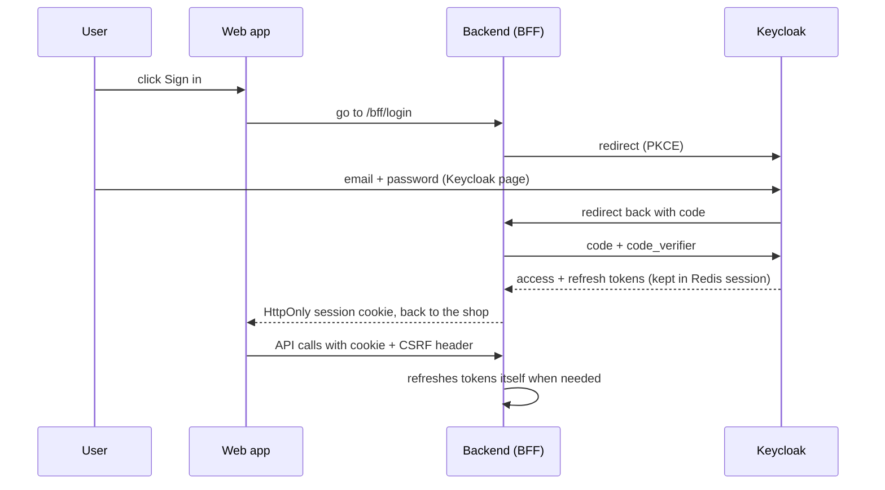

> Source of truth: this file is a copy of the live design doc. Live version: https://claude.ai/artifact/9gykGWLs5ALGW7rappCiFW. If they differ, ask the owner which one wins.

Frontend design doc · v5

# KMicro Frontend Design

Owner: krprod · Date: 30 Oct 2026 · Status: draft for review

This document covers the web frontend for the new KMicro app. It is one of three design docs: [Backend](https://claude.ai/artifact/C8raxyWLmuBLcZHVGKYfHT) (the modulith), **Frontend** (this one) and **Deployment** (to be written). The frontend is built on the existing [kmicro-frontend](https://github.com/krprod/kmicro-frontend) repo, alongside the backend.

Status labels: **Locked** agreed in our discussion · **Proposed** my suggestion, waiting for your OK · **Open** needs your answer.

## Decisions

| Area         | Decision                                                                                                                                                   | Status         |
|--------------|------------------------------------------------------------------------------------------------------------------------------------------------------------|----------------|
| Codebase     | Reuse kmicro-frontend. Work on a `v2` branch until it replaces `main`.                                                                                     | **Locked** |
| Timeline     | Web built side by side with backend phase 1. Phase 2 is the mobile app only. Phase 3+ adds later features.                                                 | **Locked** |
| Stack        | Keep React 19, Vite, TypeScript, Tailwind, shadcn/ui, Redux Toolkit, React Router, React Hook Form.                                                        | **Locked** |
| Login        | Keycloak, through the backend (BFF) for web. Social login (Google, Facebook) added later in Keycloak, with no frontend rewrite.                            | **Locked** |
| Tokens       | Web: BFF. Tokens stay on the server; the browser has only an HttpOnly session cookie + CSRF token. Mobile: PKCE with tokens in the phone's secure storage. | **Locked** |
| API layer    | TypeScript client generated from the backend's OpenAPI. Server data through RTK Query.                                                                     | **Locked** |
| Cart         | Server cart only. Guests send `X-Cart-Token`. The client never sends prices.                                                                               | **Locked** |
| Wishlist     | Saved on the server (customer module), so it works on every device.                                                                                        | **Locked** |
| Search       | Through the backend's `/search` API, never straight to Meilisearch. Filters kept in the URL.                                                               | **Locked** |
| Admin        | Same app, separate lazy-loaded `/admin` area, visible only with role `ADMIN`.                                                                              | **Locked** |
| Forms        | React Hook Form + **Zod** (replaces Yup). Server validation errors shown next to the matching field.                                                       | **Locked** |
| SEO          | Stay a Vite single-page app. Add page titles, meta tags and a sitemap now. Pre-render product pages later if needed (section 9).                           | **Locked** |
| Languages    | English only for now. All text goes through `react-i18next`, so adding a language means adding one file.                                                   | **Locked** |
| Font         | Figtree (one family).                                                                                                                                      | **Locked** |
| Mobile       | React Native, sharing API types and logic with web through a small shared package.                                                                         | **Locked** |
| Dependencies | Strict supply-chain rules: pnpm, no install scripts, 7-day release cooldown, pinned versions, scanning (section 13).                                       | **Locked** |
| Testing      | Build first, check in the browser, write a regression test only when something breaks (section 15). No test suites up front.                                                        | **Locked** |
| Hosting      | Covered in the deployment doc.                                                                                                                             | **Open**   |

## Scope and timeline

The frontend follows the backend module by module, so the 20–40 testers can start as soon as checkout works end to end.

| Step                                                                       | Frontend work                                                                                                                                 | Needs backend                            |
|----------------------------------------------------------------------------|-----------------------------------------------------------------------------------------------------------------------------------------------|------------------------------------------|
| 1\. Plumbing                                                               | Keycloak login, generated API client, error handling, new folder structure                                                                    | Keycloak + OpenAPI from any first module |
| 2\. Browse                                                                 | Product list, product page with variants, star rating and reviews, categories, search with filters (incl. rating)                             | catalog, search, settings, review        |
| 3\. Cart                                                                   | Server cart, guest token, merge on login                                                                                                      | cart                                     |
| 4\. Checkout                                                               | Guest and logged-in checkout, address, totals from server, payment (fake + Razorpay), order result                                            | ordering, payment, inventory             |
| 5\. Account                                                                | Profile, addresses, wishlist, my orders (with tracking info), write and edit reviews for delivered items, guest order view by link            | customer, ordering, review               |
| 6\. Admin                                                                  | Products and variants, option types, stock, orders (ship with tracking, record refund), coupons, review moderation, customers, store settings | all admin APIs                           |
| **Ready for testers after step 4.** Steps 5–6 continue while testing runs. |                                                                                                                                               |                                          |
| Phase 2                                                                    | Mobile app (React Native) with the same features as web                                                                                       | same API                                 |
| Phase 3+                                                                   | Refunds via Razorpay, carrier tracking, abandoned-cart push opt-in, seller area                                                               | later modules                            |

## Keep and change

From the review of the current repo (about 12k lines of TypeScript).

### Keep

- The tech stack, Tailwind theme and shadcn/ui components.
- Page designs and layouts: header, footer, sidebars, product cards, cart list, order progress bar, address cards, admin tables and forms.
- Route guards (`PublicRoutes`, `PrivateRoutes`, `AdminRoutes`), lazy-loaded pages, the error boundary, dark mode.
- Grafana Faro monitoring.

### Change

| Now                                                            | Problem                                                | New                                                                                |
|----------------------------------------------------------------|--------------------------------------------------------|------------------------------------------------------------------------------------|
| Own sign-in, sign-up and email-verify forms                    | Duplicates what Keycloak does, and does it less safely | Removed. Keycloak's pages handle sign-in, sign-up, verify email and reset password |
| Token + user saved in `localStorage`                           | Any injected script can steal it                       | Tokens in memory, refreshed silently                                               |
| Admin decided by reading roles from the token by hand          | Fragile; easy to get wrong                             | Roles read from the OIDC user profile in one place (`useRoles()`)                  |
| ~35 `callApi` calls inside components, hand-typed paths        | Hard to change; types can drift from the backend       | Generated client + RTK Query hooks per feature                                     |
| `user.id` in URLs (`/orders/user/{id}`)                        | Matches the old insecure API                           | `/api/v1/me/…`; user comes from the token                                          |
| Cart in `localStorage`, sends price and name to server         | Client could set prices; cart lost across devices      | Server cart: SKU + quantity only                                                   |
| Wishlist in `localStorage` only                                | Lost across devices                                    | Depends on the wishlist decision (section 17)                                      |
| `withCredentials` sent as a header; 5 s timeout overrides 30 s | Bugs: the option does nothing; slow calls fail         | Fixed in the new API layer                                                         |
| Two toast libraries, two icon sets, two fonts, lodash          | Larger bundle, mixed look                              | One of each (section 12)                                                           |
| Hard-coded mock data (`product-data.ts`, `order-data.ts`)      | Mixed with real code                                   | Moved to MSW mocks used only by tests and dev                                      |
| No tests                                                       | Changes break things silently                          | Test plan in section 15                                                            |

## Project structure

Code is grouped by feature, matching the backend modules, so each part is easy to find and change.

``` code
src/
├── app/                 # router, store, providers (auth, theme, query)
├── api/
│   ├── generated/       # types + endpoints from OpenAPI (never edited by hand)
│   └── baseApi.ts       # RTK Query base: URL, auth header, cart token, errors
├── features/
│   ├── catalog/         # product list, product page, variant picker
│   ├── search/          # search box, filters, results
│   ├── cart/
│   ├── checkout/        # address, summary, payment, result
│   ├── account/         # profile, addresses, my orders
│   ├── guest-orders/    # order view from email link
│   └── admin/           # catalog, option-types, inventory, orders, customers, settings
├── shared/
│   ├── ui/              # shadcn components
│   ├── layout/          # header, footer, sidebars
│   ├── money/           # formatMoney, useStore()
│   └── hooks/, lib/
└── test/                # MSW handlers, test utils
```

Rule: a feature may use `shared` and `api`, but not another feature's internals. An ESLint import rule enforces this, like Spring Modulith does on the backend.

## Login

**Web uses the BFF pattern (Backend for Frontend):** the backend does the Keycloak login and keeps the tokens. The browser only ever has a session cookie, which JavaScript cannot read. **The mobile app** logs in with PKCE itself and keeps tokens in the phone's secure storage (section 16).



- The session cookie is `HttpOnly`, `Secure` and `SameSite=Lax`, with a `__Host-` name prefix. JavaScript can't read it, and other sites can't send it.
- CSRF protection: the backend sets a readable `XSRF-TOKEN` cookie. The app copies it into an `X-XSRF-TOKEN` header on every change (POST, PUT, DELETE).
- The web app and the API must be on the same site (e.g. `shop.example.com` and `api.example.com`, or one domain with `/api`). Details go in the deployment doc.
- The app learns who is logged in from `GET /bff/me` (name, email, roles). No token is ever decoded in the browser.
- Sign up, forgot password and email verification are Keycloak pages. Keycloak's login theme can be styled to match the shop (later task).
- After login, the backend merges the guest cart into the user's cart.
- Roles shown in the UI are for display only. The backend checks every request.
- Logout (`POST /bff/logout`) ends both the app session and the Keycloak session.

### Google and Facebook login (later)

Keycloak supports this out of the box ("identity brokering"):

1.  Create an app at Google and at Facebook, and paste their client ID and secret into Keycloak. No code changes.
2.  "Continue with Google / Facebook" buttons appear on the Keycloak login page. The shop can also show its own buttons, which send the user straight to Google or Facebook (`kc_idp_hint`).
3.  If someone already has an account with the same email, Keycloak asks them to confirm before linking the accounts. This stops account takeover.
4.  Provider rules to plan for: Google needs a verified consent screen; Facebook needs app review, a privacy policy URL and a data-deletion URL.

The mobile app uses the same Keycloak setup, so social login works there too.

## API and data

- **Generated client:** `@rtk-query/codegen-openapi` reads the backend's OpenAPI file and writes typed endpoints and hooks. If the backend changes a field, the frontend build fails until it's fixed, instead of breaking at runtime.
- **Server data** (products, cart, orders) lives in the RTK Query cache. **UI state** (dialogs, filters) stays in small Redux slices or component state. `redux-persist` is removed.
- **One base query** sends the session cookie (`credentials: 'include'`), the `X-XSRF-TOKEN` header on changes and `X-Cart-Token`, sets a 30 s timeout, and turns Problem Details errors into one shape: `{ status, code, message, fieldErrors }`.
- **Errors:** field errors go next to the form field; `401` starts login; `403` and `404` show their own pages; other errors show a toast with a "try again" action.
- **Idempotency:** checkout creates one `Idempotency-Key` (`crypto.randomUUID()`) per attempt and reuses it on retry.
- **Cache refresh:** RTK Query tags (Cart, Order, Product) refresh the right data after changes.

## Cart

1.  On the first "Add to cart", the backend returns a cart token. The app saves it in `localStorage` and sends it as `X-Cart-Token`. The token only identifies a cart and can't buy anything alone, so `localStorage` is acceptable here.
2.  The cart shows prices, tax and totals **from the server response**. The client never adds up prices itself.
3.  Items that became unavailable (out of stock, or no price after a currency change) are shown greyed out with a reason and can be removed.
4.  After login, the guest cart is merged and the token is cleared.
5.  Quantity changes are sent with a short delay (debounce), so fast clicks make one request.
6.  **Coupon box** in the cart and at checkout. The server returns the new totals or a clear reason ("Minimum order is ₹999"). The app never calculates the discount itself.

## Checkout and payment

1.  **Who:** sign in, or continue as guest with email. Guests can tick "create my account".
2.  **Address:** choose a saved address or enter a new one.
3.  **Review:** items, tax line (name from settings, e.g. "GST 18%"), shipping fee or "Free shipping", total. All from the server.
4.  **Pay:** `POST /checkout` with the idempotency key. The response has payment details:
    - *Razorpay:* open Razorpay Checkout (their script) with the returned order ID.
    - *Fake provider (dev only):* a simple screen with "Succeed" and "Fail" buttons.
5.  **Result:** show "Confirming payment…" and check order status every 2 s, for up to about 60 s, until it is `PAID` or failed. The webhook on the backend decides, not the browser.
6.  **Failure:** "Payment failed" with "Try again", which calls the retry endpoint. Stock stays reserved until the order expires.

The Razorpay script loads only on the payment step, not on every page.

## Browse, search and variants

- **Search:** the search box calls `/api/v1/search`. Results come back with facet counts (category, price range, options like "Size: M", in stock), shown as filters.
- **URL holds the filters** (`/search?q=shirt&size=M&sort=price_asc`), so a search can be shared, bookmarked and reached with the back button.
- The app never talks to Meilisearch directly. The key stays on the server and the backend controls what's searchable.
- **Variant picker:** built from the product's option types (Size, Color, Weight…, as defined by admin). Combinations that don't exist or are out of stock are disabled. Price, images and stock update when the shopper changes options.
- **Reviews:** average stars and count near the price; review list below the product, newest first, with paging. "Write a review" shows only for customers whose order with that product was delivered. Review text is shown as plain text, never as HTML.
- Category pages use `/api/v1/products?category=` and still work if search is down.

### SEO

- **Now:** each page sets its own title, description and share-preview tags (Open Graph). The backend serves a `sitemap.xml` of products and categories. Product pages add structured data (schema.org `Product`), so Google can show price and stock.
- **Later, if Google ranking matters:** React Router (already used) has a "framework mode" that can pre-render product and category pages to HTML. It's the same React code, so it stays compatible with the React Native plan.
- Next.js is not used. Its server components add server-side attack surface (a critical React Server Components flaw hit Next.js apps in Dec 2025), and this app doesn't need them.

## Money and store settings

- On start, the app loads `GET /api/v1/store`: store name, currency, tax name and rate, whether prices include tax, shipping rules. It's cached for the session.
- All amounts are shown with `Intl.NumberFormat` using the store currency (₹1,299.00, \$12.99…). Amounts come from the API as strings, so no rounding errors appear in JavaScript.
- Price labels follow the tax mode: "incl. GST" or "+ tax at checkout".
- A "free shipping above X" hint is shown in the cart when that setting is on.

## Admin area

Lives under `/admin`, loads only for `ADMIN` users, and is split into its own code bundle so shoppers never download it.

| Screen         | What admin does                                                                                                                                             |                        |
|----------------|-------------------------------------------------------------------------------------------------------------------------------------------------------------|------------------------|
| Dashboard      | Today's orders, failed payments, low stock                                                                                                                  | **Reuse + change** |
| Products       | Create and edit products, choose option types, generate variants, set price per variant, upload images                                                      | **Reuse + change** |
| Option types   | Create Size, Color, Weight… and their values                                                                                                                | **New**            |
| Categories     | Create and order categories                                                                                                                                 | **New**            |
| Inventory      | Stock per SKU, adjust stock, low-stock list                                                                                                                 | **New**            |
| Orders         | List and filter, view detail, move status (only allowed moves), add carrier + tracking number when shipping, record a refund done in the Razorpay dashboard | **Reuse + change** |
| Coupons        | Create, edit, turn off; see how often each was used                                                                                                         | **New**            |
| Reviews        | List reviews, hide or unhide with a reason                                                                                                                  | **New**            |
| Customers      | List and view; account actions go to Keycloak                                                                                                               | **Reuse + change** |
| Store settings | Name, currency, tax (name, %, included or added), shipping (flat fee, free above), order number prefix                                                      | **New**            |
| Re-pricing     | After a currency change: list of unpriced products, edit or upload CSV                                                                                      | **New**            |
| Search         | "Rebuild search index" button and status                                                                                                                    | **New**            |
| API docs       | Links to Swagger and Springwolf                                                                                                                             | **Reuse**          |

Admin edits send the record's `version`. If someone else saved first, the screen says so and reloads, instead of silently overwriting.

## UI and libraries

| Area              | Keep                                     | Remove                             |
|-------------------|------------------------------------------|------------------------------------|
| Toasts            | `sonner` (comes with shadcn)             | `react-toastify`                   |
| Icons             | `lucide-react` (comes with shadcn)       | Font Awesome (4 packages)          |
| Fonts             | Figtree (friendly, clear at small sizes) | Inter                              |
| Validation        | `zod`                                    | `yup`                              |
| Utilities         | Native JS + a tiny debounce helper       | `lodash`, `lodash.debounce`        |
| Token decode      | From the OIDC library                    | `jwt-decode`                       |
| State persistence | none                                     | `redux-persist`                    |
| Mock data         | MSW mocks                                | `product-data.ts`, `order-data.ts` |

### Forms: why Zod instead of Yup

- Yup works, so this isn't urgent. But Zod is now the most common choice with React Hook Form and TypeScript.
- One schema gives both the validation and the TypeScript type (`z.infer`), so form types can't drift.
- The forms are being rewritten anyway, so switching now costs almost nothing.
- Zod can also check API responses in dev mode, catching backend and frontend mismatches early.

### Text and languages

- No text is written straight into components. All of it goes through `t('cart.empty')` with `react-i18next`. English lives in `locales/en.json`.
- Numbers, money and dates use the browser's `Intl` formatting, so they adapt when a language is added.
- Layout uses logical CSS (start/end instead of left/right), so right-to-left languages work later.

### UX basics

- Loading skeletons instead of full-screen spinners. Empty states with a next step ("Your cart is empty — browse products").
- Works well at phone width; checkout tested on small screens first.
- Accessibility (WCAG 2.1 AA basics): labels on every input, keyboard navigation, visible focus, readable contrast in both themes.
- Images: sizes and formats chosen per screen; lazy loading below the fold.

## Security

### Tokens: decided

Current guidance for browser apps (the IETF "OAuth for Browser-Based Apps" best practice) ranks the options like this:

| Pattern                       | How it works                                                                                                                                                                                             | Safety                                                                                       | Cost                                                                                                                                  |
|-------------------------------|----------------------------------------------------------------------------------------------------------------------------------------------------------------------------------------------------------|----------------------------------------------------------------------------------------------|---------------------------------------------------------------------------------------------------------------------------------------|
| A. BFF (Backend for Frontend) | The backend does the Keycloak login and keeps the tokens in a server session (stored in Redis). The browser gets only an `HttpOnly`, `Secure`, `SameSite` session cookie. JavaScript never sees a token. | Highest. A script injected into the page cannot steal a token.                               | Backend gets a second login mode for web (mobile keeps Bearer tokens). Needs CSRF protection. Web and API must share one site domain. |
| B. PKCE, tokens in memory     | The browser logs in with PKCE and holds tokens in memory (what this doc assumed so far).                                                                                                                 | Good. Tokens are not saved, but an injected script running in the page could still use them. | Simplest. Matches the mobile app.                                                                                                     |

**Decision: A (BFF) for web, B for the mobile app.** This app takes payments and holds addresses, so the extra safety is worth the cost, and Redis is already in the stack. BFF is not used for mobile: the standard for native apps (RFC 8252) is PKCE through the system browser, with tokens in the phone's secure storage, which scripts can't reach.

### Rules for all frontend code

- No tokens or personal data in `localStorage` or `sessionStorage`. The only stored values are the cart token, theme and language.
- Nothing secret in `VITE_*` env vars. They end up in the public bundle, so only URLs and client IDs go there.
- No `dangerouslySetInnerHTML`. If rich text is ever needed (e.g. product descriptions), it is cleaned with DOMPurify first.
- Strict Content Security Policy: scripts only from our own site and Razorpay; connections only to our API, Keycloak and Faro; no inline scripts; `frame-ancestors 'none'`. The exact header goes in the deployment doc.
- URLs from data (images, links) are checked to start with `https:` or `/`; never `javascript:`.
- Redirect after login only to paths on our own site (no open redirects).
- Hiding admin buttons is for convenience only; the backend enforces every rule.
- Error screens never show stack traces or raw server messages.

### Dependencies and supply chain

npm had several serious attacks in 2025, for example hijacked popular packages (`chalk`, `debug`) and the self-spreading "Shai-Hulud" worm, which ran through install scripts. Rules:

1.  **Few packages.** Each new package needs a reason, and a check of maintainers, age, weekly downloads, open issues and install scripts. The clean-up in section 12 removes 8+ packages.
2.  **pnpm instead of npm.** It blocks package install scripts by default (only allow-listed ones run). Its `minimumReleaseAge` setting refuses versions published less than 7 days ago, since most hijacked versions are caught within days.
3.  **Exact versions** in `package.json` (no `^` or `~`). The lockfile is committed, and CI installs with `pnpm install --frozen-lockfile`.
4.  **Automated scanning** in CI: `pnpm audit` plus OSV-Scanner. The build fails on high or critical issues.
5.  **Renovate** (or Dependabot) opens update PRs with a 7-day cooldown, grouped weekly. Security fixes come sooner, after review.
6.  **Account safety:** 2FA on GitHub, protected `main` branch, GitHub secret scanning on.
7.  Third-party scripts loaded at runtime: only Razorpay, only on the payment step.

The backend gets the same rules in its own doc: Renovate for Maven with a cooldown, OSV/OWASP dependency check, Docker images pinned by digest and scanned with Trivy.

### Versions

Latest stable versions on npm, checked 30 Oct 2026. Final pins are chosen at project start, respecting the 7-day rule.

| Package                         | Repo now   | Latest           | Note                                                                                                         |
|---------------------------------|------------|------------------|--------------------------------------------------------------------------------------------------------------|
| react / react-dom               | 19.2       | 19.3.1           | Minor update                                                                                                 |
| react-router                    | 7.13       | 8.5.1            | Major: follow the upgrade guide                                                                              |
| vite                            | 7.2        | 8.3.5            | Major                                                                                                        |
| typescript                      | 5.9        | 7.0.2            | Major (new native compiler): check tooling support first                                                     |
| tailwindcss                     | 4.1        | 4.3.3            | Minor                                                                                                        |
| @reduxjs/toolkit                | 2.11       | 2.13.0           | Minor                                                                                                        |
| react-hook-form                 | 7.72       | 7.91.0           | Minor                                                                                                        |
| zod                             | new        | 4.6.7            | Replaces yup                                                                                                 |
| OIDC library                    | jwt-decode | none             | Not needed on web (BFF). Mobile uses an app-auth library (e.g. Expo AuthSession), chosen in the mobile phase |
| i18next / react-i18next         | new        | 26.5 / 17.1      |                                                                                                              |
| vitest / msw / @playwright/test | new        | 5.0 / 3.0 / 1.64 |                                                                                                              |
| react-native                    | new        | 0.88.1           | Mobile app phase                                                                                             |

## Monitoring

- Keep Grafana Faro: front-end errors, page load times (Web Vitals) and user sessions, sent to the same Grafana stack as the backend.
- Faro adds a `traceparent` header to API calls, so one trace shows the click in the browser and the work in the backend.
- No personal data (emails, addresses) in Faro logs.

## Testing and quality

**Approach: build first, check the real app, test only what broke.** No test driven development and no test suites written up front.

1. Build the screen or flow.
2. Check it in the browser against the local backend (and the spec).
3. If the output is wrong: fix the root cause and add **one regression test** for that bug.

| Kind | When | Tools |
|---|---|---|
| Static checks | Always, on every pull request | TypeScript strict mode, ESLint (incl. feature import rule), Prettier |
| Regression test | Only after a bug is found | Vitest + React Testing Library + MSW; Playwright for a broken end to end flow |

## Mobile app prep (phase 2)

- The mobile app uses **React Native**.

- The backend API is already mobile-safe: header cart token, PKCE login, versioned paths (backend doc).

- To share code, the repo becomes a pnpm workspace (monorepo) when mobile work starts:

  ``` code
  apps/web        # this React app
  apps/mobile     # React Native app
  packages/core   # generated API types, Zod schemas, money + variant logic, i18n texts
  ```

- To keep sharing easy from day 1: logic that doesn't touch the browser (money formatting, variant rules, validation schemas) is written in plain TypeScript with no DOM code.

- The mobile app logs in with PKCE and keeps tokens in the phone's secure storage (Keychain / Keystore).

## Open items

| Item    | Question                                                 | Status       |
|---------|----------------------------------------------------------|--------------|
| Hosting | Vercel, Nginx container, or other: in the deployment doc | **Open** |

KMicro Frontend Design · v5 draft · Based on a review of github.com/krprod/kmicro-frontend and the backend design doc.
